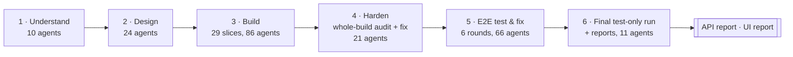
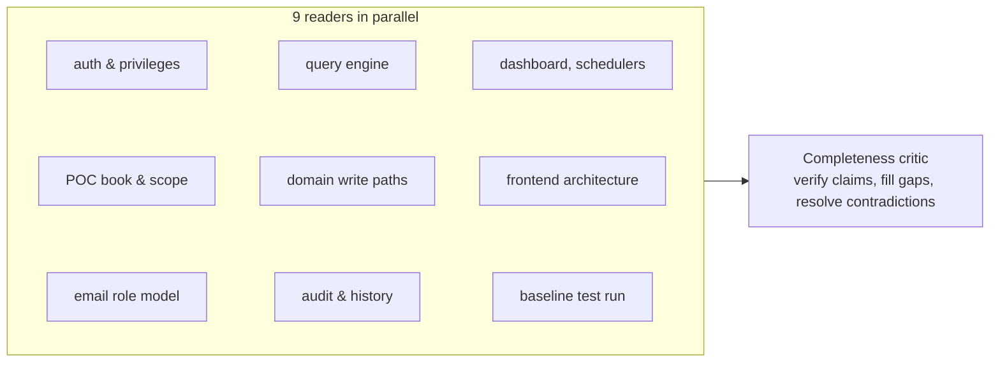
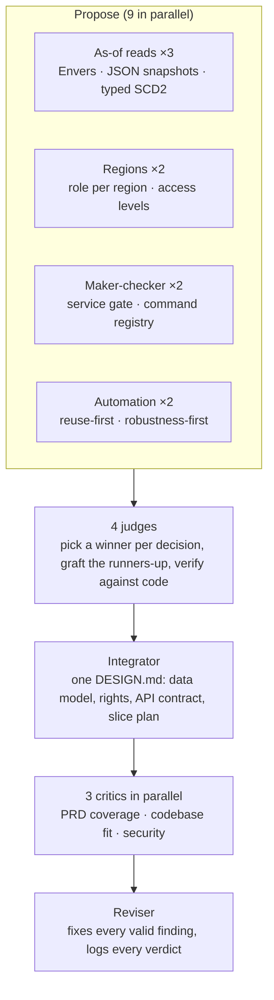
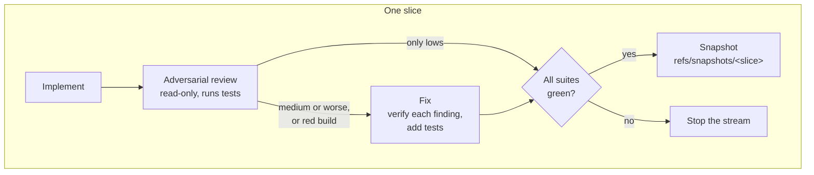
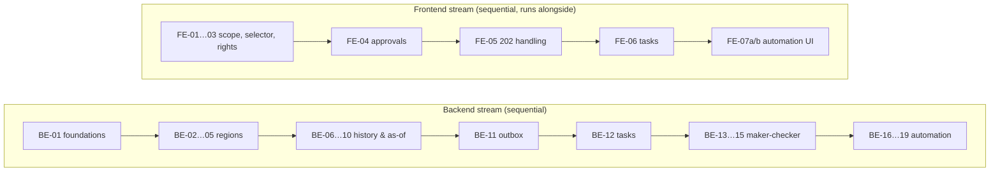
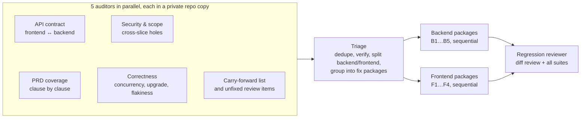
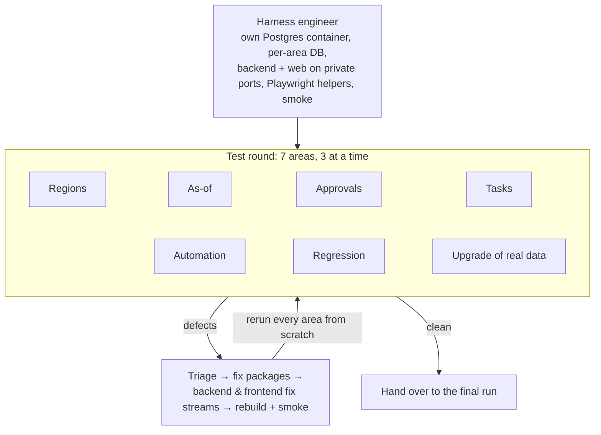

# Workflow architecture

How the automation engine, regions, maker-checker and as-of PRD
([`../requirements/automation-regions-approvals-asof.md`](../requirements/automation-regions-approvals-asof.md))
was designed, built, reviewed and tested by orchestrated Claude agents, from an empty design to a tested branch.

## At a glance

| | |
|---|---|
| Elapsed | 26 Sep 00:23 UTC → 28 Sep 02:30 UTC (about 50 h wall clock; about 32 h of it active) |
| Orchestration | 1 orchestrating session running 15 workflow runs, 218 subagents in total |
| Model | Claude Opus 5.5 (1M context) for every agent |
| Tokens | 2.09 billion, 96% of them cache reads |
| Cost at list API prices | $827.75 (see [cost](#cost)) |
| Change produced | 565 files, +81,407 / −1,408 lines (backend 443 files, frontend 122, mail-service untouched) |
| Tests before → after | backend 119 → 852 · mail-service 24 → 24 · Flutter 61 → 505 · analyzer 0 → 0 issues |
| Final E2E run | 1,033 cases on PostgreSQL + Chromium: API 767/767 pass; UI 258/266 pass, 0 fail, 8 blocked by one pre-existing defect |
| State | Uncommitted on `feature/automation-regions-approvals-asof`; every step snapshotted under `refs/snapshots/*` |

## The pipeline

Six phases. Each phase is one or more workflow runs, and the orchestrating session read every run's result
before starting the next, so a human-level check sat between phases.

| # | Phase | Question it answers | Pattern | Output |
|---|---|---|---|---|
| 1 | Understand | What exists, and what will the PRD touch? | Parallel readers + completeness critic | 9 codebase maps + critic review ([`../implementation/codebase-map/`](../implementation/codebase-map/)) |
| 2 | Design | How should each hard part work? | Judge panel → integrate → adversarial critique → revise | [`../design/DESIGN.md`](../design/DESIGN.md) (4,650 lines), 4 [decision records](../design/decision-records/) |
| 3 | Build | Build it, one reviewable slice at a time | Two parallel streams of implement → review → fix → green gate → snapshot | 29 slices, [build logs](../implementation/build/) |
| 4 | Harden | What did slice-by-slice review miss? | Five-lens audit → triage into fix packages → parallel fix streams → regression review | [triage and fix logs](../implementation/hardening/) |
| 5 | E2E test & fix | Does it work end to end on real infrastructure? | Isolated test pool → triage → fix → rebuild → full retest, looped | [results, fixes, triage per round](../regression/2026-09-28/data/) |
| 6 | Final run | What is the state of the delivered build? | Test only, no fixes; suite re-run as written plus an independent exploratory pass | [API and UI reports](../regression/2026-09-28/report/) |

## Workflow runs

Every run, in order. Agents, tokens and cost are counted from the subagent transcripts. Wall time includes idle
time; active time counts only gaps under 5 minutes.

| Started (UTC) | Run | Script | Agents | Tokens | Cost | Wall | Active |
|---|---|---|---|---|---|---|---|
| 26 Sep 00:24 | Understand: codebase mapping | `understand-geneinvoice.js` | 10 | 83 M | $34.14 | 0.5 h | 0.5 h |
| 26 Sep 00:56 | Design: judge panel + critique | `design-automation-regions-asof.js` | 24 | 236 M | $135.07 | 11.5 h | 3.0 h |
| 26 Sep 12:27 | Build wave 1: BE-01…05, FE-01…03 | `build-slices.js` | 25 | 250 M | $81.06 | 3.5 h | 3.5 h |
| 26 Sep 14:43 | Build: FE-04…FE-07b | `build-slices.js` | 15 | 117 M | $37.31 | 2.4 h | 2.4 h |
| 26 Sep 15:57 | Build wave 2: BE-06…10 | `build-slices.js` | 18 | 194 M | $60.67 | 4.1 h | 4.1 h |
| 26 Sep 20:06 | Build wave 3: BE-11…15 | `build-slices.js` | 14 | 254 M | $72.05 | 3.9 h | 3.9 h |
| 27 Sep 00:02 | Build wave 4: BE-16…19 (resumed after a usage limit) | `build-slices.js` | 14 | 264 M | $72.82 | 11.4 h | 4.2 h |
| 27 Sep 11:31 | Harden (stopped at launch, see [incidents](#incidents-and-what-changed)) | `harden-build.js` | 5 | 0.3 M | $0.52 | — | — |
| 27 Sep 11:32 | Harden: whole-build test-and-fix pass | `harden-build.js` | 16 | 196 M | $55.47 | 1.7 h | 1.7 h |
| 27 Sep 13:16 | E2E: harness + rounds 1–3 | `e2e-test-and-fix.js` | 36 | 280 M | $144.74 | 8.2 h | 6.6 h |
| 27 Sep 21:28 | E2E fix + retest (stopped: wrong arguments) | `e2e-fix-retest.js` | 1 | 0.03 M | $0.14 | — | — |
| 27 Sep 21:29 | E2E: fix round 3 + rounds 4–5 | `e2e-fix-retest.js` | 22 | 67 M | $35.71 | 2.4 h | 2.0 h |
| 27 Sep 23:54 | E2E: fix round 5 + targeted round 6 | `e2e-fix-retest.js` | 7 | 18 M | $9.47 | 0.8 h | 0.7 h |
| 28 Sep 00:44 | Final test-only run + report data | `final-test-and-report-data.js` | 9 | 69 M | $30.64 | 1.5 h | 1.5 h |
| 28 Sep 02:13 | Final run: tasks exploratory completion | `final-tasks-completion.js` | 2 | 5 M | $2.13 | 0.2 h | 0.2 h |
| — | Orchestrating session (planning, reviewing results, reports) | — | — | 61 M | $55.81 | — | — |
| | **Total** | | **218** | **2.09 B** | **$827.75** | | |

The scripts are in [`scripts/`](scripts/). One script can serve several runs: `build-slices.js` ran five times
with different slice lists, and `e2e-fix-retest.js` three times with different defect seeds and area filters. Raw
per-run figures are in [`workflow-runs.json`](workflow-runs.json).

### Agents by role

| Role | Agents | What they did |
|---|---|---|
| Map / critic | 9 + 1 | Read one subsystem each; the critic checked the maps against each other and the code |
| Propose / judge | 9 + 4 | Proposed designs from different angles; one judge per open decision |
| Integrate / critique / revise | 3 + 3 + 5 | Merged the design, attacked it through three lenses, fixed it (the 2 extra integrate and 4 extra revise runs were restarts after the laptop slept) |
| Implement / review / fix | 31 + 30 + 50 | 29 slices; 3 reruns after interruptions (2 implement, 1 review); fixes cover 25 slice fix passes, 9 hardening packages and 16 E2E packages |
| Audit / triage / regression review | 10 + 7 + 1 | Whole-build audits (5 per run; one run was stopped at launch), defect triage for hardening and E2E rounds 1–5 (one triage agent was in the run stopped at launch) |
| E2E setup / test / rebuild | 1 + 38 + 5 | Harness engineer, area testers (seven areas, six rounds), rebuild-and-smoke after each fix round |
| Final run | 11 | Fresh build + unit checks, 7 area testers, tasks completion, 2 report compilers |

## Phase by phase

### 1 · Understand

Ten agents read the codebase before anyone designed anything.

- Each reader owned one subsystem and wrote a map with file:line citations and the conventions a new feature must
  copy. One reader ran the baseline suites (119 / 24 / 61 tests, all green) so later phases had a known starting
  point.
- The critic spot-checked 25 claims (9 were wrong or needed a caveat), found the earlier PRD in git history, and
  resolved seven contradictions between maps, such as where trigger events should be captured and whose identity
  a rule runs as. Those resolutions became fixed constraints for the design phase.
- Two findings shaped everything after: the backend silently ignores unknown query parameters, so a missed
  `regionIds` reader would leak data with no error; and background threads have no logged-in user.

### 2 · Design

A judge panel, then an integrated design, then an adversarial critique.

- **Pinned decisions.** Seven constraints the critic had already settled were given to every design agent as
  non-negotiable: a transactional outbox, rules running as their owner, region stored on each record, one reader
  for `regionIds`/`asOf`, a single Clock, H2-compatible tests, and existing tests staying green. This stopped the
  panel relitigating settled questions.
- **Winners.** Typed per-entity version tables for as-of; a role (what) plus per-region access levels (where) for
  regions; a gate inside the eight money-moving service methods for maker-checker; reuse-first for automation.
- **Critique.** 61 findings (11 high); all fixed, 5 sub-points declined with reasons, logged in DESIGN.md §11.
- **The slice plan.** DESIGN.md §9 split the build into 21 backend slices (strictly sequential) and 8 frontend
  slices (sequential among themselves, independent of the backend because they build against the §6 API
  contract), each with its file list, dependencies and acceptance tests.

### 3 · Build

Two streams of slices, each slice going through the same four-step chain.

- **Every slice agent read the same things first:** DESIGN.md §1–2 and §9.0, its own slice entry and every
  section that entry referenced, then the running build logs of both streams, because later slices must build on
  what earlier slices actually did, not on what the design assumed.
- **Definition of done:** `mvn test` on backend and mail-service, or `flutter analyze` plus `flutter test`, with
  zero failures, and every test named in the slice's acceptance list present and meaningful. Baseline test files
  could not be weakened.
- **Review results:** 121 findings across 29 slices (1 high, 38 medium, 82 low); 25 slices needed a fix pass. The
  high one was real: in BE-02 a customer login could write to other customers' records.
- **Hand-offs between slices** went through three files: `LOG-backend.md` and `LOG-frontend.md` (what was built,
  deviations from the design, gaps), and `CARRY-FORWARD.md` (deferred items for the hardening phase). All three
  are in [`../implementation/build/`](../implementation/build/).
- **Scheduling:** waves of 4–6 backend slices, one workflow run per wave, so the orchestrator could read results
  and adjust between waves. When the frontend finished its wave early, its remaining five slices were launched
  immediately in their own run instead of waiting for the backend.

### 4 · Harden

A whole-build pass, because slice reviewers only ever saw one slice.

- 38 audit findings became 9 fix packages (41 packaged items after splitting cross-stream findings); 2 were
  rejected with reasons and 4 product questions got a default.
- The correctness auditor found that a history test which had failed once under full-suite load was exposing a
  real race in history link versioning. It was fixed with an owner lock.
- The regression reviewer found 3 more issues (1 high), which were carried into phase 5, where fixing was allowed.

### 5 · E2E test and fix

Real infrastructure, isolated from the developer's own services, looped until clean.

- **Isolation.** Every area got its own PostgreSQL database in a dedicated container (`gi-e2e-db`), its own backend
  on a 181xx port and its own web server on a 182xx port. The developer's running services and databases were
  never contacted, except one read-only `pg_dump` of the dev database for the upgrade test.
- **Suites are code.** Each tester wrote an automated, re-runnable suite (API cases plus Playwright UI cases through
  Flutter's accessibility tree), so later rounds re-ran the whole suite cheaply and the final run could replay it
  unchanged. The harness and suites are in [`../regression/2026-09-28/scripts/`](../regression/2026-09-28/scripts/).
- **Retest everything.** Rounds 2–5 re-ran every area on a fresh database after each fix; round 6 was a targeted
  retest of the three areas the last fixes touched. The full retest is how round 3 caught a high-severity
  regression introduced by a round-2 fix.

| Round | Cases passed | Product defects found | Fixed before the next round |
|---|---|---|---|
| 1 | 607 / 642¹ | 13 (4 high, 2 medium, 7 low) + 3 carried from phase 4 | yes, 7 packages (1 finding became a product decision) |
| 2 | 685 / 692 | 2 | yes |
| 3 | 707 / 717 | 3 (1 high: a regression caused by a round-2 fix) | yes |
| 4 | 750 / 752 | 2 | yes |
| 5 | 789 / 791 | 2 | yes |
| 6 (targeted: 3 areas) | 404 / 404 | 0 | — |

¹ From the testers' returns. The round-1 result files for asof and regions were not kept, so `data/runs/r1/` holds
only the other five areas (409 / 442), and the report's round history shows 528 / 561 (regions taken from its run
log, asof missing).

What only this phase could find: automation never ran on PostgreSQL (large-text columns read outside a
transaction, invisible on H2), and upgrading the developer's real database broke every save because of leftover
tables from earlier work. Unit tests on H2 passed throughout.

### 6 · Final test-only run

Nothing was fixed in this phase, by the user's instruction.

- A fresh build from the final source, snapshotted as `refs/snapshots/FINAL`, plus every unit and static check.
- Every area's suite re-run exactly as written on a fresh database.
- An exploratory pass: the same tester, who had not written the suite and was told not to read its case list, then
  wrote at least 15 new cases per area (217 in all) from the PRD and the API contract, aimed at what the suite's
  author might have missed.
- Two compiler agents recounted every number from the result files and built the report data.

| | Total | Passed | Failed | Blocked |
|---|---|---|---|---|
| API | 767 | 767 | 0 | 0 |
| UI | 266 | 258 | 0 | 8 |

The 8 blocked UI cases are all caused by one defect the exploratory pass found, TSK-F-1: a deep link opened on a
fresh page load lands on the Dashboard. The baseline router has the same behaviour, so it predates this work. It
is reported, not fixed. Reports: [`../regression/2026-09-28/report/`](../regression/2026-09-28/report/).

## Guardrails

| Guardrail | How it worked | Why |
|---|---|---|
| No commits | Agents could run only read-only git commands; progress was recorded with `tools/snap.sh`, which writes a commit object under `refs/snapshots/<name>` using a temporary index, never touching HEAD, the branch, the index or the working tree | The developer decides what is committed; every step can still be diffed or rolled back |
| Diff per slice | `tools/sdiff.sh <snapshot> <dir>` shows exactly what one slice or package changed, even with both streams writing to the same tree | Reviewers see only their slice |
| Green gate | A stream stopped the moment a slice or package could not be made green | Later slices never build on a broken base |
| Stream separation | Backend agents could touch only `backend/`, frontend agents only `frontend/` | Two streams can share one working tree safely |
| Private workspaces | Parallel auditors and testers that needed to build did so in their own copy or on their own ports | Concurrent Maven builds in one folder corrupt each other |
| Isolation rules | Every E2E prompt listed the developer's live containers and ports as off limits, and allowed only `e2e_*` databases in `gi-e2e-db` | The developer's own deployment stayed untouched |
| Structured results | Reviewers, auditors and testers returned JSON against a schema (severity, evidence, fix) | The orchestrator could count, route and stop on them in code |
| Fix vs report | Phases 3–5 fix what they find; phase 6 only reports | The final reports describe the delivered build, not a build fixed during testing |
| Product decisions | Where the PRD was silent, triage picked the default the PRD and design best supported, applied it, and recorded it | Work never stalled on a question; every default is listed for review |

## Incidents and what changed

| When | What happened | Effect | Change made |
|---|---|---|---|
| Design phase | The laptop slept repeatedly mid-response | 15–72 min stalls; 2 integrator and 4 reviser restarts; each restart re-cached its whole context (15.4 M tokens of cache writes in design against 2.4 M in mapping) | `caffeinate` kept the machine awake for the rest of the build |
| Build wave 4 | Account usage limit reached | About 7.3 h pause; one review and one implementation failed cleanly | Resumed from the journal; finished agents replayed from cache at no cost, and the snapshot showed no half-written slice |
| Harden launch | Five auditors would have run Maven in the same folder at once | Would have produced false failures | Stopped within a minute; relaunched with a private repo copy per auditor ($0.52 lost) |
| E2E round 3 | A round-2 fix (readable names in approval diffs) broke as-of reads of those approvals | High-severity regression | Caught by the full retest; fixed with tests pinning both behaviours |
| E2E fix launch | The seed defect list was passed as a placeholder string | Would have triaged nonsense | Stopped within seconds, relaunched with the real list ($0.14 lost) |
| E2E triage | The regions and regression areas both produced `REG-` defect ids | Ids would collide in triage | Each area given its own prefix |
| Final run | The round label `final` is not a number, so every area's suite wrote to `runs/rNaN`. The other testers copied their results over; the tasks tester returned before doing so and before running its exploratory cases | 31 cases unrun | A two-agent follow-up ran them as written and recounted the report |

## Cost

At Opus 5.5 list API prices: $4 input, $20 output, $5 (5 min) or $8 (1 h) cache write, $0.20 cache read, per
million tokens.

| Phase | Cost | Share |
|---|---|---|
| Understand | $34.14 | 4% |
| Design | $135.07 | 16% |
| Build (29 slices) | $323.91 | 39% |
| Harden | $55.99 | 7% |
| E2E test & fix (6 rounds) | $190.06 | 23% |
| Final run | $32.77 | 4% |
| Orchestrating session | $55.81 | 7% |
| **Total** | **$827.75** | |

By component: cache writes (about $387) and cache reads (about $403) cost nearly the same, output about $37
(4.5%), and uncached input almost nothing. A typical slice cost $6–12 including its review and fix; the largest were tasks (BE-12, $21) and the
rule engine (BE-16, $21).

## Reusing this

- **The scripts** in [`scripts/`](scripts/) are the exact workflow programs used, run by the Claude Code Workflow
  tool. `build-slices.js` and `e2e-fix-retest.js` take their slice lists, snapshot names, defect seeds and area
  filters as arguments, so they can be re-run for another design. Their path constants point at the scratch
  layout the run used (design, map, build and harness folders side by side); point them at `docs/` before reuse.
- **The E2E suites** re-run after `build-dist.sh`; see
  [`../regression/2026-09-28/README.md`](../regression/2026-09-28/README.md#running-it-again) and the harness rules
  in [`../regression/2026-09-28/scripts/README.md`](../regression/2026-09-28/scripts/README.md). They need Docker
  (for their own Postgres container), Java 17, Maven, Flutter and Node.
- **Snapshots and diffs** use [`tools/snap.sh`](tools/snap.sh) `<name>` and [`tools/sdiff.sh`](tools/sdiff.sh)
  `<name> [dir] [--stat]` from anywhere inside the repository.
- **Cost tracking** used [`tools/usage.py`](tools/usage.py), which reads the session and subagent transcripts,
  counts each API call once, and prices it.

What made the biggest difference, in order:

1. Mapping the code before designing, and pinning the critic's resolutions as constraints for the design.
2. A design with an explicit slice plan and API contract, so two streams could build in parallel.
3. An adversarial reviewer on every slice, with a green gate before the next one.
4. End-to-end tests on the production database engine. Unit tests on H2 missed the two worst defects.
5. Re-running every area after each fix (rounds 2–5), which caught a regression a targeted retest would have missed.
